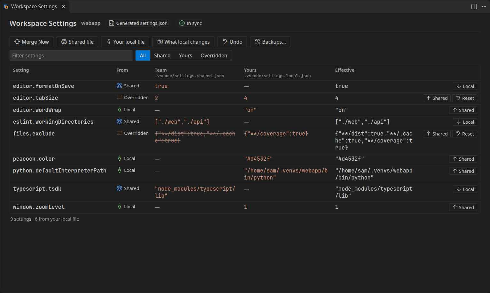
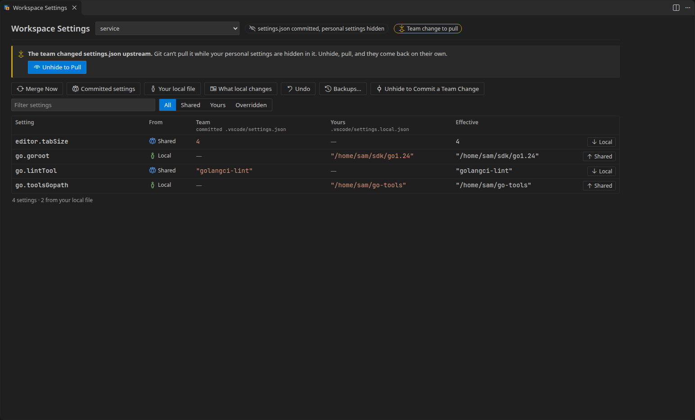
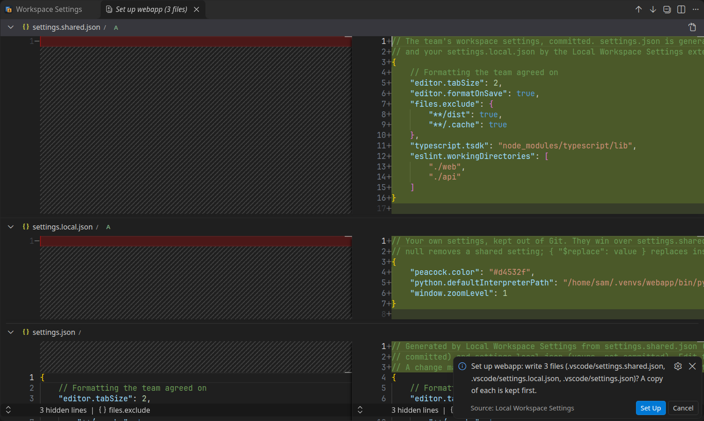
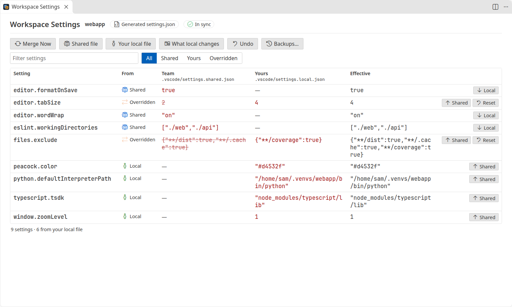

<h1 align="center">
  <br>
  Local Workspace Settings
</h1>

<p align="center">
  A git-ignored <code>settings.local.json</code> for VS Code: commit the team's workspace settings, keep your own out of Git.
</p>

<p align="center">
  <a href="https://github.com/heyliamme/local-workspace-settings/blob/main/CHANGELOG.md">Changelog</a> ·
  <a href="https://github.com/heyliamme/local-workspace-settings/blob/main/CONTRIBUTING.md">Contributing</a>
</p>



## The problem

Teams want to commit `.vscode/settings.json`: formatter, tab size, excluded folders, the
TypeScript SDK. But the same file collects everyone's personal settings: a Python
interpreter under someone's home folder, Peacock colours, a zoom level, a JDK path. Either
the file never gets committed, or every `git status` shows someone's tweaks.

VS Code reads exactly one settings file per folder and has no local override. The request
is one of the most upvoted in its tracker:
[microsoft/vscode#40233](https://github.com/microsoft/vscode/issues/40233) (a git-ignored
`settings.local.json`, open since 2017, ~1,500 reactions),
[#15909](https://github.com/microsoft/vscode/issues/15909) (settings inheritance, ~1,700) and
[#282806](https://github.com/microsoft/vscode/issues/282806) (a local `.code-workspace`).

## How it works

Since VS Code can only read `settings.json`, this extension keeps two layers and writes
their merge into it:

| Layer | Who | In Git |
| --- | --- | --- |
| The team's settings: `.vscode/settings.shared.json`, or the committed `settings.json` | everyone | committed |
| `.vscode/settings.local.json` | you | ignored |

- **Your values win.** Objects such as `files.exclude` or `"[python]"` blocks merge key by
  key. Lists replace the team's list unless you choose otherwise.
- **Changes made in `settings.json` are moved to the right file.** The Settings editor,
  Peacock, the Python extension choosing an interpreter: all of them write to
  `settings.json`. The extension sees which settings changed and saves them to your local
  file (or asks, or sends them to the team's file, as you configure).
- **Nothing is lost.** Every write is backed up first and is atomic. A file that doesn't
  parse is never overwritten. A setting changed in two places at once is a question, not a
  guess.

Because the merge has to be written into a real file, how that file lives in Git is the
real choice. There are two ways, picked during setup.

## Two ways to keep settings.json in Git

### Generated settings.json (recommended)

The team commits `.vscode/settings.shared.json`. `settings.json` is generated from it and
your `settings.local.json`, and Git ignores both of those.

- `git status` stays clean and pulls are never blocked.
- The generated file starts with a comment saying where its settings come from.
- Teammates without the extension copy `settings.shared.json` to `settings.json` (or
  install it: a folder with `settings.shared.json` is merged as soon as it opens).
- Switching an existing repository means one commit: add `settings.shared.json` and the
  ignore rules, and stop tracking `settings.json`. Setup offers each step.

### Keep settings.json committed

Nothing changes for the team: `settings.json` stays the committed file. Your
`settings.local.json` is applied to it, and Git is told to skip the file with
`git update-index --skip-worktree`, so your values never show in `git status`.

The honest cost of `skip-worktree`:

- **A pull that changes `settings.json` stops** with "Your local changes would be
  overwritten". The extension checks after every fetch and offers **Unhide to Pull**: the
  file goes back to the committed version and Git can see it again; you pull, and your
  personal settings come back on their own.
- **Changing the team's settings** needs **Unhide settings.json to Commit a Team Change**
  (or **Move to shared** in the overview): the file shows the committed settings plus your
  change, ready to commit. Once it is committed, your settings come back.
- The flag lives in your clone only. A fresh clone needs setup again.

This mode also works for a committed `.code-workspace` file: overrides for its `settings`
block go in `<name>.code-workspace.local.json` next to it.



## Getting started

1. Open a folder that has a `.vscode/settings.json`.
2. Run **Local Workspace Settings: Set Up in This Workspace…** (or **Set Up…** in the
   overview).
3. Pick a mode, then tick the settings that are just yours. Paths under your home folder,
   colours, zoom and interpreters are ticked for you.
4. Every file it will write is shown as a diff. Click **Set Up**.
5. It offers the ignore rules, for `.gitignore` (the team's) or `.git/info/exclude` (this
   clone only), and, in the generated mode, to stop tracking `settings.json`. Nothing in
   Git changes without a click.



## Where changed settings go

When `settings.json` changes and the change didn't come from the layers (you used the
Settings editor, another extension wrote a setting, or you edited it by hand):

1. A rule in **`localWorkspaceSettings.routes`** decides: `peacock.*`,
   `workbench.colorCustomizations` and `python.defaultInterpreterPath` go to your local
   file by default.
2. Otherwise **`localWorkspaceSettings.defaultRoute`** decides: `local` (default), `ask` or
   `shared`. After a move to your local file, a notification offers **Move to Shared**.
3. When asked, **Always Just Me for `<prefix>.*`** remembers the answer for this workspace.

A setting changed in `settings.json` and in your local file since the last merge is a
conflict: you choose which one stays. Until a change is sorted, nothing is merged; the
status bar says so and the overview lists it with **Just me**, **Team** and **Discard**.

Sharing a change shares only what changed. Add one entry to `files.exclude` or change one
key of a `[python]` block and choose **Team** (or **Move to Shared** afterwards): that entry
goes to the team, and the entries only you had stay in your local file. The same goes for a
list that `arrayMerge` appends to or joins: only the entries you added or removed are
shared. The overview's **Shared** button is different: it gives the team the whole value
you see.

In committed mode, "the team's file" is the commit, so a change routed there becomes a team
change to commit.

## Merge rules

| In `settings.local.json` | Result |
| --- | --- |
| `"editor.tabSize": 4` | Replaces the team's value |
| `"files.exclude": { "**/coverage": true }` | Added to the team's `files.exclude` |
| `"[python]": { "editor.rulers": [100] }` | Merged into the team's `[python]` block |
| `"cSpell.words": ["mine"]` | Replaces the team's list (see below) |
| `"editor.formatOnSave": null` | Removes the team's setting for you |
| `"files.exclude": { "**/dist": null }` | Removes one key of the team's object |
| `"files.exclude": { "$replace": { "x": true } }` | Replaces the whole object, no merging |

Lists replace by default. **`localWorkspaceSettings.arrayMerge`** changes that per setting
(`*` allowed): `append`, `prepend` or `union`, for example `{ "cSpell.words": "union" }`.
Put it in `settings.shared.json` to apply it to the whole team.

A `$replace` stays a `$replace`: changing that setting in the Settings editor writes the new
value as `{ "$replace": … }` again, so later additions by the team still stay out.

The shared and local files open as JSON with comments, with the same setting completions
and checks as `settings.json`. Those checks don't know `null` and `$replace`, so they mark
them as the wrong type (for example "Expected boolean"); the merge reads them correctly. A key written twice in one object is refused with its name
and line (VS Code would quietly use the last one).

Comments and formatting are kept: the generated `settings.json` keeps the shared file's
comments, and moving a setting edits your files in place.

## The overview

**Show Settings Overview** lists every setting of a folder with its origin (**Shared**,
**Local**, **Overridden**, **Removed**), the team's value, yours and the effective one, and
**Local**, **Shared** and **Reset** buttons to move it. It also shows settings waiting to be
sorted, files that don't parse, a pull that needs unhiding, and missing ignore rules. The
status bar item opens it and turns yellow when something needs you.



## Commands

| Command | What it does |
| --- | --- |
| **Set Up in This Workspace…** | Chooses the mode, previews every file, writes them, offers the ignore rules |
| **Show Settings Overview** | The overview above |
| **Merge Now** | Merges again, and asks again about settings you dismissed |
| **Open Shared Settings** | `settings.shared.json`, or the committed `settings.json` (read-only) |
| **Open Local Settings** | Your `settings.local.json` (created if missing) |
| **Show What Local Settings Change** | A diff of the team's settings against the merge |
| **Undo Last Change** | Puts back the files from before the last change this extension made. Undoing the setup turns local settings off for that folder again |
| **Restore a Backup…** | The same, for any earlier backup |
| **Move a Setting to Local…** | Takes a setting out of the team's file into yours |
| **Move a Setting to Shared…** | Gives the team your value |
| **Remove a Local Override…** | Goes back to the team's value |
| **Keep Local Settings Out of Git…** | Adds the ignore rules (after you pick where), and stops tracking a generated `settings.json` |
| **Unhide settings.json to Pull** | Committed mode: shows the committed file so a pull can go through |
| **Unhide settings.json to Commit a Team Change** | Committed mode: shows the committed file for you to change and commit |
| **Hide Personal Settings Again** | Committed mode: re-applies your settings and hides the file (changes made meanwhile are sorted first) |
| **Stop Using Local Settings Here…** | Turns local settings off for a folder: `settings.json` becomes a plain file again, and in committed mode Git sees it again |

## Settings

| Setting | Default | |
| --- | --- | --- |
| `localWorkspaceSettings.defaultRoute` | `local` | Where a setting changed in `settings.json` goes: `local`, `ask` or `shared` |
| `localWorkspaceSettings.routes` | Peacock, colour customizations, Python interpreter → `local` | Per-setting rules, `*` allowed |
| `localWorkspaceSettings.arrayMerge` | `{}` | How lists combine: `replace`, `append`, `prepend`, `union` |
| `localWorkspaceSettings.backups` | `20` | Backups kept per folder |
| `localWorkspaceSettings.header` | `true` | Start a generated `settings.json` with a comment |
| `localWorkspaceSettings.statusBar` | `true` | Show the status bar item |

Except `arrayMerge`, these are user settings only, so a repository can't change how its
own files are routed.

## Safety

- **Backups.** Before every write, the files it changes are copied into the extension's own
  storage (readable only by you), keeping the last 20 per folder.
- **Atomic writes.** A temporary file next to the target, flushed, then renamed. Nothing is
  written through a symbolic link inside the folder.
- **No overwrites.** Each file is checked again right before it is replaced (after the
  backup is taken); one that changed in between is read again and the change sorted. A `settings.json`, shared or local file with a syntax error is never written; the
  status bar and overview say which file and which line.
- **No links.** A `settings.json`, shared or local file that is a symbolic link is neither
  read nor written, so a repository can't have another file of yours merged into
  `settings.json`.
- **Branch switches.** In generated mode, a checkout without `settings.shared.json` (a branch
  from before the team switched) pauses the merge: `settings.json` is left to Git and your
  local file is kept. It resumes when `settings.shared.json` is back.
- **No loops.** A merge that would produce the same text writes nothing, so its own writes
  never trigger another.
- **Restricted Mode.** In an untrusted folder nothing is written and `git` is never run:
  the overview is read-only and commands explain why.
- **No network, no telemetry.** Git is only run locally, to read the index and set the
  skip-worktree flag; nothing commits, pulls or pushes on its own.

## Coming from Workspace Config+

[Workspace Config+](https://marketplace.visualstudio.com/items?itemName=swellaby.workspace-config-plus)
uses the same two file names, `.vscode/settings.shared.json` and `settings.local.json`, so
a repository set up for it works here without renaming anything. Two differences:

- **Lists.** Workspace Config+ joins the shared and local lists; here a local list replaces
  the shared one. To keep joining them, put `"localWorkspaceSettings.arrayMerge": { "*":
  "append" }` in `settings.shared.json`.
- **Don't run both.** Each would rewrite the `settings.json` the other generated. While
  Workspace Config+ is installed, this extension does not take over a folder that has
  `settings.shared.json` on its own, and setup offers only the committed mode; disable
  Workspace Config+ for the workspace and reload to use the generated mode.

## Limitations

- **The merge is a real file.** VS Code and other tools see `settings.json`, not the layers.
  Something reading `settings.json` before the merge runs (a fraction of a second after a
  change) sees the previous merge.
- **Generated mode needs everyone on board** (or a README line telling teammates to copy
  `settings.shared.json`), because `settings.json` is no longer committed.
- **Committed mode needs Git**: `git` on the `PATH`, or VS Code's `git.path` setting.
- **Committed mode depends on `skip-worktree`**, with the trade-offs above. Tools that run
  `git stash` or `git checkout -f` on your behalf can drop or restore the file; the
  extension notices and merges again, and backups cover the rest.
- **Workspace files use the committed mode only**, and only their `settings` block is
  merged (not `launch` or `tasks`). Unhiding one keeps your uncommitted `folders`, `launch`
  and `tasks` changes in the file, so Git shows them too until you commit or stash them. `.vscode/launch.json` and `tasks.json` are not merged.
- **Turn it off before uninstalling.** In committed mode the extension keeps Git's
  skip-worktree flag on `settings.json`; uninstalled, nothing clears it, and a pull that
  changes the file stops while `git status` looks clean. Run **Stop Using Local Settings
  Here…** first (or `git update-index --no-skip-worktree .vscode/settings.json`). In generated
  mode, `settings.json` stays ignored: copy `settings.shared.json` over it if you leave.
- **Folder settings only.** User settings and profiles are VS Code's own business.
- **Virtual workspaces** (no files on disk) are not supported.
- File watching is backed by a check every two seconds, for file systems where watchers
  miss changes (some remote and WSL setups).

## Install

From the [Visual Studio Marketplace](https://marketplace.visualstudio.com/items?itemName=heyliam.local-workspace-settings),
from [Open VSX](https://open-vsx.org/extension/heyliam/local-workspace-settings) (VSCodium,
Cursor and other editors), or from a terminal:

```bash
code --install-extension heyliam.local-workspace-settings
```

## License

[MIT](LICENSE). Third-party notices are in [ThirdPartyNotices.txt](ThirdPartyNotices.txt).
